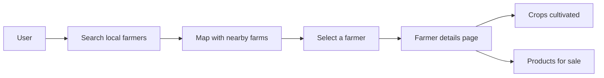
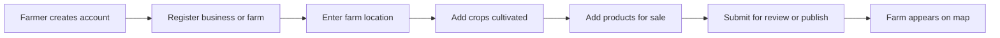

# Tup

Empty starter workspace for the Tup project.

## Simple Platform Diagram

This shows a simple web platform flow where a user searches for nearby farmers on a map, selects one, and views the crops they cultivate and the products they sell.

## Farmer Registration Flow

### Data Registered During Farmer Onboarding

- Farmer name or business name
- Phone number and email address
- Farm address
- Map pin location using latitude and longitude
- Service area or delivery radius
- Crops cultivated
- Products currently available for sale
- Availability by season or harvest period

### Location Data Needed From the Farmer

To place the farm correctly on the map, the farmer should register:

- Full farm address: village, town, district, region, and postal code if available
- Exact map point: latitude and longitude from a dropped map pin or GPS
- Farm name for display on the map
- Landmark or directions: useful when rural addresses are unclear
- Service radius: how far the farmer delivers or serves customers

The minimum reliable location data is usually a map pin with latitude and longitude plus a readable farm address.

## Status

This workspace is intentionally unscaffolded. No framework, runtime, or language-specific setup has been added yet.

## Next

Add the application stack you want in this folder, such as Vite, Next.js, Node.js, or Python.