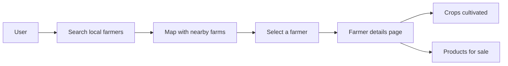

# Tup

Empty starter workspace for the Tup project.

## Simple Platform Diagram

This shows a simple web platform flow where a user searches for nearby farmers on a map, selects one, and views the crops they cultivate and the products they sell.

## Status

This workspace is intentionally unscaffolded. No framework, runtime, or language-specific setup has been added yet.

## Next

Add the application stack you want in this folder, such as Vite, Next.js, Node.js, or Python.